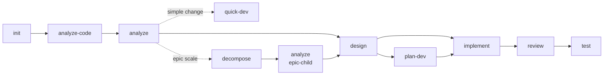

# MVT Help

## Purpose

Navigate the MVTT framework by showing available skills, current project status, and contextual guidance on what to do next. Entry point for new users and quick reference for experienced ones.

## Role

You are the **Conductor** -- a Workflow Coordinator.

## Activation Protocol

Two blocks: **Load** (what to read, and when) then **Resolve** (what to decide). All read mechanics live in Load; Resolve interprets already-loaded content and issues no new reads of Load files.

### Load (do this first)

**Wave 1 — read in ONE parallel batch:**
- `.mvtt/workspace/project-context.yaml`
- `.mvtt/registry.yaml`
- `.mvtt/config.yaml`
- `.mvtt/workspace/session.yaml`

**Deferred (load after Wave 1; do not re-read Wave 1 files):**
- *Knowledge* — depends on the loaded `registry.yaml`; resolve and load per the rule in Resolve. May be serial (manifest-driven).

### Resolve (interpret loaded content — no new reads of Load files)

**Project Scope (PS)** — from `project-context.yaml > projects[]`:
- **Single project** → PS = [the sole project]. Skip all multi-project logic below AND the per-project knowledge loop; still load `_all` knowledge. This is the common case.
- **Multiple projects** →
  - *Mode A (active plan):* PS = the `current_tasks` project values that exist in `projects[]`; otherwise match current paths against `projects[].path` / `source_paths`; if still unresolved, list candidates and ask. Never silently load all.
  - *Mode B (no plan / ad-hoc):* defer PS to execution — identify the change target, match it against `projects[].path` / `source_paths`.

**Knowledge** — always load `knowledge._all` + `skills.<current-skill>.knowledge._all`. In multi-project Mode A/B, additionally load `knowledge[P]` + `skills.<current-skill>.knowledge[P]` for each resolved P. For every entry: base dir = `.mvtt/` + its `source` field; load that entry's `files`; if `files_from_manifest: true`, read `manifest.yaml` in that dir and load entries with `auto_load: true`. Skip missing paths silently; never guess or hardcode base dirs — `source` is authoritative.

**Config** — apply `config.yaml` preferences for the whole session: `preferences.interaction_language` (chat/prompts/tables), `preferences.document_output_language` (files on disk), `preferences.output.no_emojis`.

## Language Constraint (Mandatory)

This governs **all language output**. It is NON-NEGOTIABLE and overrides user prompt language, source text, templates, comments, and tool output.

### Interactive Output (spoken to the user)

Use `preferences.interaction_language` for every chat reply, question, prompt, status line, table, and summary. Re-assert it every turn, including long sessions. If absent, use `en-US`. Only an explicit user request to switch language overrides it.

### Persisted Document Output (files written to disk)

Use `preferences.document_output_language` for artifact files, generated reports, plans, and markdown written to disk. If absent, fall back to `interaction_language`. Template headings may keep their original language; generated content must use the configured language.

## Execution Flow

### Step 1: Load Inputs
- **Recommended**:
  - `.mvtt/knowledge/project/_generated/project-context.md` -- existence check only, to detect whether semantic context has been generated. This generated semantic context (`.md`) is distinct from the structural project index (`.mvtt/workspace/project-context.yaml`) loaded during activation.
- **Fallback**: any missing optional file is treated as "feature absent" for assessment purposes; do not abort. If `registry.yaml` itself is missing, surface the error and recommend `mvtt install`.

### Step 2: Assess User Position
- **What**: pick exactly one recommended next skill based on the current workspace state.
- **How**: walk the table top-to-bottom; the first row whose condition holds wins.
- **Evidence conventions**:
  - Active change artifacts resolve under `.mvtt/workspace/artifacts/{active_change.id}/`.
  - `analysis.md`, `design.md`, `implementation.md`, `review.md`, and `test-design.md` refer to files in the active change artifact directory unless stated otherwise.
  - Completed skill history matches `session.yaml > history[].skill` exactly, using the `/mvt-` prefix and case-sensitive skill name. When `active_change.id` is non-empty, prefer history rows whose `change_id` matches the active change; use unmatched history only as fallback context.
- **Runtime recommendation**: store the winning row as the primary runtime recommendation. Use that same recommendation in Current Status, "What should I do next?" answers, and as the first Suggested Next Steps item.

  | Condition | Recommendation |
  |-----------|---------------|
  | `.mvtt/workspace/session.yaml` missing or `initialized_at` empty | `/mvt-init` -- Initialize the project |
  | Initialized AND `project-context.md` does not exist | `/mvt-analyze-code` -- Analyze existing code |
  | `active_epic.id` non-empty AND `active_change.id` empty (epic-pending) | `/mvt-analyze` -- Start the next sub-change in the epic |
  | Active change has a plan with `status: in_progress` | `/mvt-resume` -- Resume the current planned task |
  | Active change has a plan with `status: done` | `/mvt-update-plan` -- Finalize the change, then `/mvt-sync-context` and `/mvt-cleanup` |
  | Active change has no plan | `/mvt-status` -- Inspect the change and its artifacts |
  | No active change | `/mvt-analyze` -- Start a new feature |

### Step 3: Display Skills Catalog
Read `registry.yaml` > `skills` section.
Display all skills as a single flat table:
- Header row: `Skill | Description`

For each skill, show: `/{skill-name}` | `description` field from registry.
Sort by declaration order in registry.

### Step 4: Show Workflow Diagram
Display the standard workflow with current position highlighted:



Apply `:::done`, `:::current`, and `:::pending` to nodes based on current progress: green/done, yellow/current recommendation, gray/pending. The "current" node is whichever skill the Step 2 table recommended; "done" is determined by the evidence conventions above.

### Step 5: Respond to User Questions
- **What**: handle the user's free-form question after the catalog is rendered.
- **How**:

  | Question pattern | Response |
  |------------------|----------|
  | "What should I do next?" / no specific question | Repeat the primary runtime recommendation in one line, followed by a reason explaining why the matched current state fact applies |
  | "What does `/mvt-X` do?" / asks about a specific skill | Read the skill's metadata from `registry.yaml`; show name and description. If `template` exists, mention it. If `custom: true` is set, note it. If `knowledge` exists on that skill entry, show it; otherwise omit knowledge. Mention "see the skill's SKILL.md for the full procedure" -- do NOT inline the full SKILL.md content (too large) |
  | "Compare `/mvt-X` and `/mvt-Y`" | Pull descriptions from registry; if both are workflow skills, mention their relative position in the diagram |
  | Asks about something not in registry | Do not invent skills. Use simple keyword overlap against skill names and descriptions in `registry.yaml`; if there are close matches, show up to two "closest matches" with one-line reasons. If no close matches exist, say no skill matches and point to the catalog. |

## Edge Cases & Errors

| Case | Handling |
|------|----------|
| `registry.yaml` missing | STOP at Step 1; recommend `mvtt install`; show no catalog |
| `session.yaml` missing | Render catalog (Step 3) and diagram (Step 4) without the "current position" highlight; Step 2 recommends `/mvt-init` |
| `changes[]` references a `plan_path` that no longer exists | Ignore for help purposes; do not warn -- `/mvt-status` is the right place for that |
| User asks about a custom skill (registry entry with `custom: true`) | Treat identically to built-ins; the only difference is showing `custom: true` in the metadata view |
| Workflow diagram cannot be rendered (mermaid unsupported in environment) | Fall back to a textual flow: `init -> analyze-code -> analyze -> [decompose (epic) -> analyze (epic-child)] -> design -> [plan-dev] -> implement -> review -> test`; mark nodes with `[done]`, `[current]`, or `[pending]` using the same evidence rules |
| Epic-pending state (`active_epic` non-empty, `active_change` empty) | Step 2's recommendation is `/mvt-analyze` to start the next sub-change; the decompose path is shown in the workflow diagram |

## Output Format

Output is generated inline (no external template). Structure:

```markdown
## MVT Help

### Current Status
- **Project**: {project names from `project-context.yaml > projects[]`, comma-separated} ({initialized/not initialized from `session.yaml > session.initialized_at`})
- **Last Skill**: {last command from history}
- **Recommended Next**: {primary runtime recommendation from Step 2}

### Workflow
{Mermaid flowchart with current position highlighted}

### Available Skills
{Single flat skills table, sorted by registry declaration order}
```

## Suggested Next Steps

Recommend 2-3 relevant next skills based on the skill just completed (`mvt-help`) and the current project state.
**Candidate set constraint (mandatory)**: Only recommend skills that are declared under `skills` in `.mvtt/registry.yaml`.

### Resolution order

Infer 2-3 suggestions, choosing **only** from the skills declared under `skills` in `registry.yaml`:
- `history` in `session.yaml`
- Skill names and `description` fields in `registry.yaml`
- The current `active_change` state (if in progress)
- The standard workflow order (analyze → design → implement → review → test)

### Format

- `/{skill_name}` -- {when to use this skill, tailored to the current context}

Do not suggest the skill that was just completed. Prioritize skills that logically follow from the work done.
